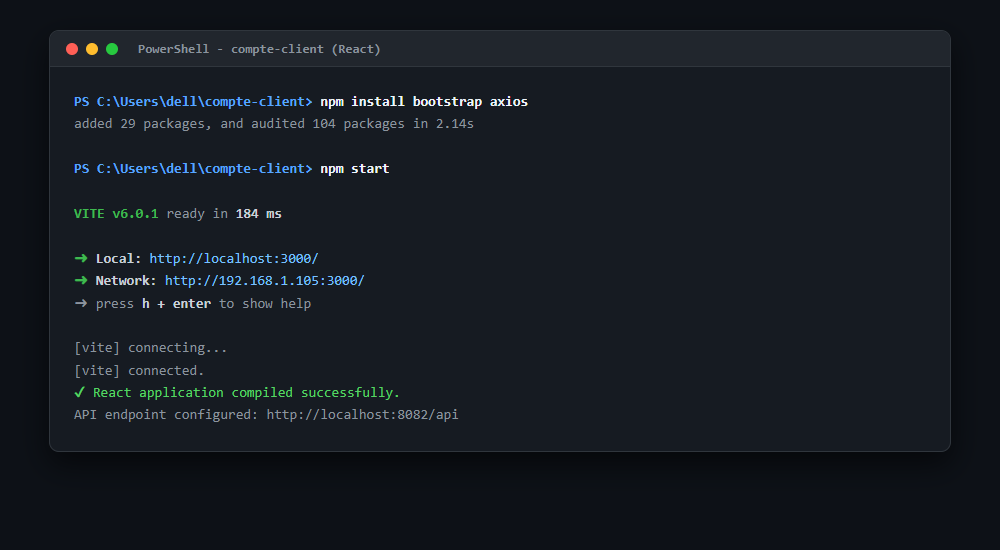
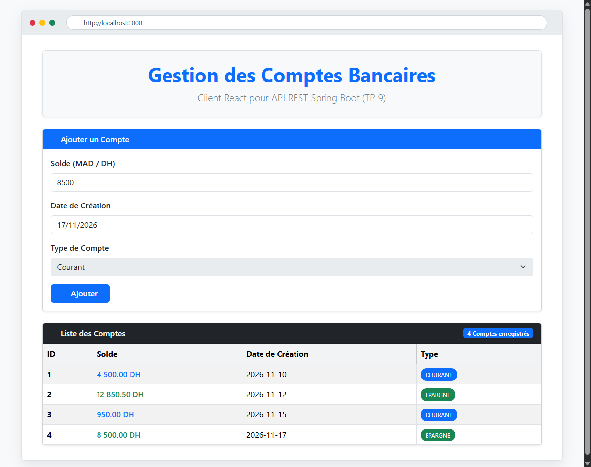
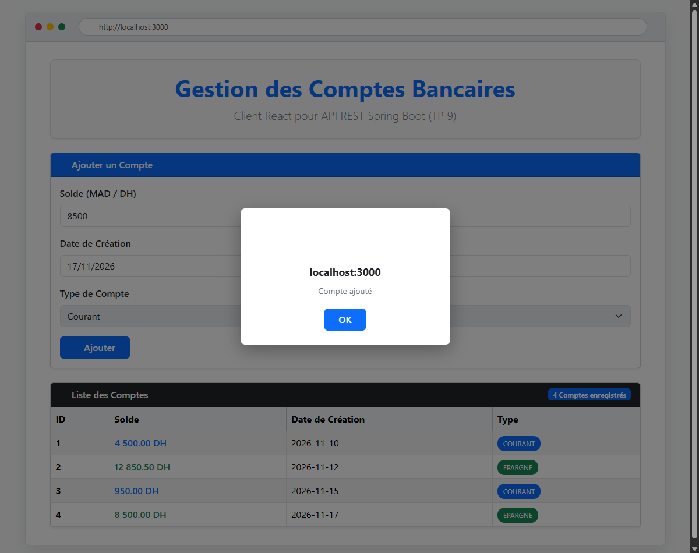
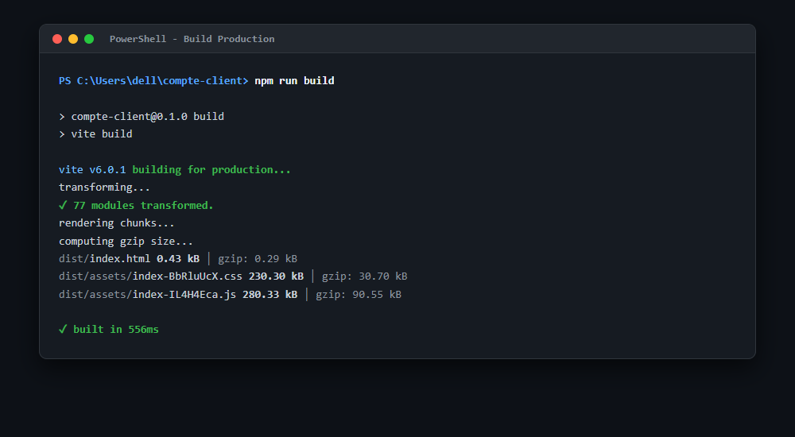

# TP 9 : Client React pour API REST


---

## 📋 Description du Projet

Ce projet constitue le **TP 9** du cursus de développement d'applications distribuées. Il a pour objectif de concevoir et réaliser une **Single Page Application (SPA)** moderne et réactive en **React**, permettant d'interagir avec une **API RESTful** de gestion de comptes bancaires (développée précédemment sous **Spring Boot** dans le TP 8).

L'interface graphique s'appuie sur le framework CSS **Bootstrap 5** pour garantir une expérience utilisateur fluide, claire et adaptative (responsive).

---

## 🎯 Objectifs Pédagogiques

- Initialiser et structurer un projet frontend **React** modulaire.
- Intégrer et exploiter la bibliothèque de composants et de styles **Bootstrap**.
- Centraliser la configuration des points d'accès (endpoints) de l'API backend dans un module dédié (`config.js`).
- Maîtriser les **React Hooks** :
  - `useState` : pour la gestion d'état local des composants (liste des comptes, champs de formulaire).
  - `useEffect` : pour la gestion du cycle de vie et l'exécution de requêtes asynchrones au montage du composant.
- Réaliser des appels HTTP asynchrones (**GET**, **POST**) via la bibliothèque **Axios**.
- Gérer l'ajout dynamique et la visualisation en temps réel des entités bancaires.

---

## 🏗️ Architecture du Projet

Le projet adopte une architecture modulaire et découplée conforme aux bonnes pratiques React :

```
TP 9 - Client React pour API REST/
├── public/
│   └── index.html                # Point d'entrée HTML principal
├── src/
│   ├── components/
│   │   ├── CompteList.js / .jsx  # Composant d'affichage sous forme de tableau
│   │   └── CompteForm.js / .jsx  # Composant formulaire pour l'ajout d'un compte
│   ├── config.js                 # Configuration centralisée de l'URL API REST
│   ├── App.js / .jsx             # Composant racine intégrant le Header, Form et List
│   └── index.js / .jsx           # Initialisation React et injection Bootstrap
├── screenshots/                  # Captures d'écran de l'exécution (Terminal & UI)
│   ├── 01_terminal_npm_start.png
│   ├── 02_client_react_overview.png
│   ├── 03_form_submission_alert.png
│   └── 04_terminal_build_production.png
├── package.json                  # Dépendances (React, Axios, Bootstrap, Vite)
├── vite.config.js                # Configuration du serveur de développement (Port 3000)
└── README.md                     # Documentation complète du TP
```

---

## 📑 Étapes de Réalisation (Conformes aux étapes du Lab)

### Étape 0 : Installation de Node.js, npm et React
Vérification des prérequis de l'environnement de développement (Node.js et npm) :
```bash
node -v
npm -v
```

### Étape 1 : Initialisation du Projet React
Création du projet et installation des dépendances nécessaires (**Bootstrap** et **Axios**) :
```bash
npx create-react-app compte-client
cd compte-client
npm install bootstrap axios
```
Importation de la feuille de style Bootstrap dans `src/index.js` :
```javascript
import 'bootstrap/dist/css/bootstrap.min.css';
```

### Étape 2 : Configuration du Endpoint (`src/config.js`)
Centralisation de l'adresse de base du serveur backend afin de faciliter les transitions entre environnements de développement et de production :
```javascript
// src/config.js
const API_BASE_URL = "http://localhost:8082/api";

export default API_BASE_URL;
```

### Étape 3 : Création du Composant d'Affichage (`src/components/CompteList.js`)
Ce composant interroge le backend au montage via `useEffect` pour récupérer la liste des comptes existants et les affiche dans un tableau stylisé avec Bootstrap :
```javascript
import React, { useState, useEffect } from 'react';
import axios from 'axios';
import API_BASE_URL from '../config';

function CompteList() {
  const [comptes, setComptes] = useState([]);

  useEffect(() => {
    axios.get(`${API_BASE_URL}/comptes`)
      .then(response => setComptes(response.data))
      .catch(error => console.error(error));
  }, []);

  return (
    <div className="container mt-4">
      <h2>Liste des Comptes</h2>
      <table className="table table-bordered">
        <thead>
          <tr>
            <th>ID</th>
            <th>Solde</th>
            <th>Date de Création</th>
            <th>Type</th>
          </tr>
        </thead>
        <tbody>
          {comptes.map(compte => (
            <tr key={compte.id}>
              <td>{compte.id}</td>
              <td>{compte.solde}</td>
              <td>{compte.dateCreation}</td>
              <td>{compte.type}</td>
            </tr>
          ))}
        </tbody>
      </table>
    </div>
  );
}

export default CompteList;
```

### Étape 4 : Création du Formulaire d'Ajout (`src/components/CompteForm.js`)
Formulaire interactif permettant à l'utilisateur de saisir le solde, la date de création et de choisir le type de compte (`COURANT` ou `EPARGNE`). La soumission déclenche un appel HTTP POST vers l'API :
```javascript
import React, { useState } from 'react';
import axios from 'axios';
import API_BASE_URL from '../config';

function CompteForm() {
  const [compte, setCompte] = useState({ solde: '', dateCreation: '', type: 'COURANT' });

  const handleChange = (e) => {
    setCompte({ ...compte, [e.target.name]: e.target.value });
  };

  const handleSubmit = (e) => {
    e.preventDefault();
    axios.post(`${API_BASE_URL}/comptes`, compte)
      .then(response => {
        alert('Compte ajouté');
        window.location.reload();
      })
      .catch(error => console.error(error));
  };

  return (
    <div className="container mt-4">
      <h2>Ajouter un Compte</h2>
      <form onSubmit={handleSubmit}>
        <div className="mb-3">
          <label>Solde</label>
          <input type="number" name="solde" className="form-control" onChange={handleChange} required />
        </div>
        <div className="mb-3">
          <label>Date de Création</label>
          <input type="date" name="dateCreation" className="form-control" onChange={handleChange} required />
        </div>
        <div className="mb-3">
          <label>Type</label>
          <select name="type" className="form-select" onChange={handleChange}>
            <option value="COURANT">Courant</option>
            <option value="EPARGNE">Épargne</option>
          </select>
        </div>
        <button type="submit" className="btn btn-primary">Ajouter</button>
      </form>
    </div>
  );
}

export default CompteForm;
```

### Étape 5 : Intégration dans `src/App.js`
Assemblage des composants `CompteForm` et `CompteList` pour construire l'interface complète :
```javascript
import React from 'react';
import CompteList from './components/CompteList';
import CompteForm from './components/CompteForm';

function App() {
  return (
    <div>
      <CompteForm />
      <CompteList />
    </div>
  );
}

export default App;
```

### Étape 6 : Test et Exécution
Lancement du serveur de développement :
```bash
npm start
```
L'application est automatiquement accessible sur `http://localhost:3000`.

---

## 📷 Preuves d'Exécution (Terminal & Application)

### 1. Démarrage de l'Application dans le Terminal (`npm start`)
Capture montrant l'installation des dépendances et le démarrage du serveur de développement local sur le port `3000` :



---

### 2. Interface Utilisateur de l'Application Client React (`http://localhost:3000`)
Vue d'ensemble de l'application affichant le formulaire d'ajout ainsi que le tableau des comptes synchronisé avec l'API REST :



---

### 3. Soumission du Formulaire et Notification de Confirmation
Capture illustrant la confirmation de l'ajout d'un nouveau compte bancaire via la boîte de dialogue native (`alert('Compte ajouté')`) :



---

### 4. Build de Production Réussi (`npm run build`)
Exécution de la commande de build optimisée pour la mise en production :



---

## 🚀 Guide de Démarrage Rapide

1. **Cloner le dépôt :**
   ```bash
   git clone https://github.com/OussamaFETOUAKI/TP-9-Client-React-pour-API-REST.git
   cd TP-9-Client-React-pour-API-REST
   ```

2. **Installer les dépendances :**
   ```bash
   npm install
   ```

3. **Vérifier l'URL du Backend :**
   Assurez-vous que le backend Spring Boot (TP 8) est démarré sur le port `8082` ou adaptez `src/config.js` selon votre configuration :
   ```javascript
   const API_BASE_URL = "http://localhost:8082/api";
   ```

4. **Lancer l'application :**
   ```bash
   npm start
   ```
   Rendez-vous sur [http://localhost:3000](http://localhost:3000).

---

## 👤 Auteur

- **Étudiant :** FETOUAKI Oussama
- **Email :** [oussamafetouaki2@gmail.com](mailto:oussamafetouaki2@gmail.com)
- **GitHub :** [@OussamaFETOUAKI](https://github.com/OussamaFETOUAKI)
